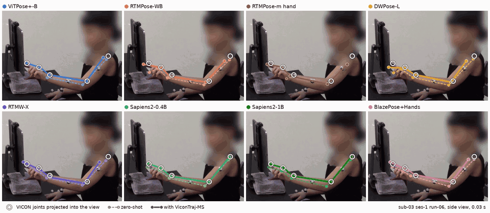
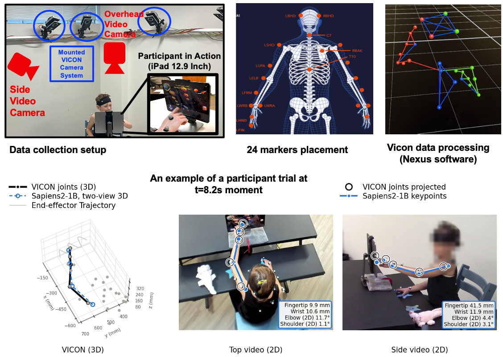
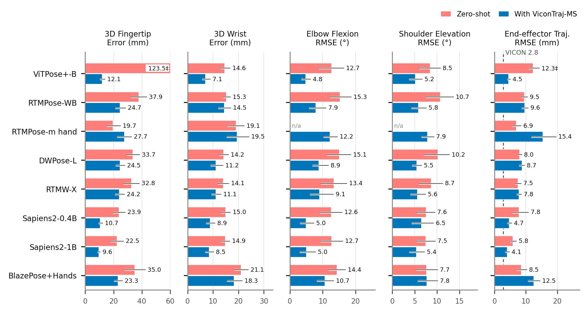

# ViKi-Traj: A Multi-modal Dataset and Benchmark for Markerless Video to Upper-Limb Kinematics


Codebase and sample data of the ViKi-Traj multimodal dataset and bechnmark (anonymous submission).


## Demo

An example of a test participant trial sub-03, visit 1, trial 6 (typically developing, left arm, 21.7 s). Precise UL kinematics tracking from top and side view video using Sapiens2-1B + ViconTraj-MS. ([full video](docs/media/demo_best_model.mp4))


An example of comparison between zero-shot (dashed, lighter) and  ViconTraj-MS (solid) on all Eight baseline model that estimates UL kinematics just from a top view video
([full video](docs/media/demo_all_models.mp4))




## Dataset
This dataset contains upper-limb movements of Children aged 5-12 years, typically developing (TD) or with unilateral cerebral palsy (UCP). Participants played reaching game on an 12.9 inch iPad while a 24-marker VICON system (100 Hz), an overhead (top) and a side camera (30 Hz), and the iPad apps (end-effector trajectory, 120 Hz) record each trial without hardware
synchronization.

| | Release v1.0 |
|---|---|
| Participants | 29 (18 TD, 11 UCP), two visits each |
| Trials | 696 (24 per participant), median 9.6 s, 128 min of movement |
| VICON | 24 markers (modified Plug-in Gait upper body), 100 Hz, 759,984 samples; 173 full recordings (C3D, 189 min) |
| End-effector trajectory | finger position on the screen, about 120 Hz, 804,462 samples; 7,315 trial and touch events |
| Video clips | 617 top, 650 side (419,367 frames, 233 min), 30 Hz, 1920x1080 (3 of the 116 source videos 1280x720) |
| Labels | 10 joints and 24 markers projected into each frame of 539 top and 535 side clips (357,068 frames) |
| Model outputs | 2D keypoints of 8 zero-shot and 8 ViconTraj-MS models (12,261 files), boxes, 3D tracks of 410 trials |
| Valid trials | VICON 556, top 522, side 488, all three streams 416 (72 min) |
| Size | 21,320 files, 12.6 GB |





Datset layout is BIDS with the Motion-BIDS extension: one trial is one run, `ses-1` and `ses-2` are the two visits, and
`derivatives/vikitraj/` holds the manifest, splits, cameras, labels, model outputs, result tables and ViconTraj-MS
checkpoints. The dataset card, [dataset/README_card.md](dataset/README_card.md), describes the files and conventions.
The dataset will be released for research through a gated Hugging Face repository with a DOI at publication;
Check One trial is in [sample_data/](sample_data/).


## Benchmark



Three benchmark tasks scored on 8 held-out test participants (5 TD, 3 UCP):

1. 2D and 3D upper-limb pose: error of the shoulder, elbow, wrist, hand and fingertip in each view and after two-view
   triangulation, against the VICON joints (E1, E2 in the code).
2. Kinematic features: elbow flexion and shoulder elevation angles (RMSE, range of motion), and the peak speed, time
   to peak speed, straightness, number of speed peaks, spectral arc length and log dimensionless jerk of the wrist and
   the end-effector (ICC(2,1) against VICON; E4).
3. End-effector trajectory: the fingertip estimate mapped to the screen and compared with the game trajectory (RMSE,
   length ratio, speed correlation; E3).

ViconTraj-MS (VICON and trajectory multi-modal supervision, E5) trains pose models on two references: the VICON joints
projected into each view, and the game trajectory projected through a screen plane fitted per VICON recording, which
labels the fingertip in every frame, also where its marker is hidden. ViTPose+-B is fine-tuned end to end, the pose
heads of Sapiens2-0.4B and Sapiens2-1B are trained on the frozen backbone, and the other five models, released as
inference graphs that cannot be trained, get a temporal head that corrects their keypoints. With ViconTraj-MS, the 3D
fingertip error of Sapiens2-1B falls from 22.5 to 9.6 mm, and fine-tuned ViTPose+-B has the lowest 3D wrist error,
7.1 mm against 14.1 mm for the best zero-shot model. ViTPose+-B reaches an RMSE of 4.8 deg for elbow flexion and
5.2 deg for shoulder elevation (12.6 and 7.5 deg for the best zero-shot models), and the ICC of the end-effector peak
speed and straightness against VICON rises from at most 0.31 to 0.82-0.88. The end-effector trajectory RMSE of
Sapiens2-1B falls from 5.8 to 4.1 mm, against 2.8 mm for the VICON fingertip.


## Installation

Python 3.10 on Linux. The GPU steps ran on one NVIDIA V100 with PyTorch 2.7.1 and CUDA 11.8.

```bash
python -m venv .venv                  # Python 3.10
source .venv/bin/activate
pip install -r requirements.txt       # PyTorch from the CUDA 11.8 index
pip install --no-deps c3d==0.5.2      # C3D writer of dataset/: its metadata asks for numpy<2, the code runs on numpy 2
git clone https://github.com/facebookresearch/sapiens2.git third_party/sapiens2
```


| Model | Source | Under `models/` |
|---|---|---|
| RT-DETR | Hugging Face `PekingU/rtdetr_r50vd_coco_o365` | `hf_cache/` |
| ViTPose+-B | Hugging Face `usyd-community/vitpose-plus-base` | `hf_cache/` |
| RTMPose-WB | RTMPose-Body2d, ONNX float export of Qualcomm AI Hub | `rtmpose_body2d/rtmpose_body2d-onnx-float/` |
| DWPose-L | `dw-ll_ucoco_384.onnx` from Hugging Face `yzd-v/DWPose` | `onnx/` |
| RTMW-X, RTMPose-m hand | ONNX archives of the RTMPose project of MMPose (below) | `onnx/<archive name>/` |
| Sapiens2-0.4B, -1B | Hugging Face `facebook/sapiens2-pose-0.4b`, `facebook/sapiens2-pose-1b` | `sapiens2/pose/` |
| BlazePose + Hands | MediaPipe Tasks `pose_landmarker_heavy.task`, `hand_landmarker.task` | `mediapipe/` |
| YuNet (face blur) | OpenCV Zoo `face_detection_yunet_2023mar.onnx` | `face/` |


## Acknowledgements

Pretrained models: ViTPose+ (Apache-2.0), RT-DETR (Apache-2.0), RTMPose, RTMW and RTMPose-m hand of OpenMMLab MMPose
(Apache-2.0; RTMPose-WB as exported by Qualcomm AI Hub), DWPose (Apache-2.0), Meta Sapiens2 (Sapiens2 License), Google
MediaPipe BlazePose and Hands (Apache-2.0), and the YuNet face detector of the OpenCV Zoo (MIT). The release follows
BIDS and its Motion-BIDS extension.


## Citation

Withheld for double-blind review.


## License

To be added at publication; the pretrained weights keep their own licenses.
