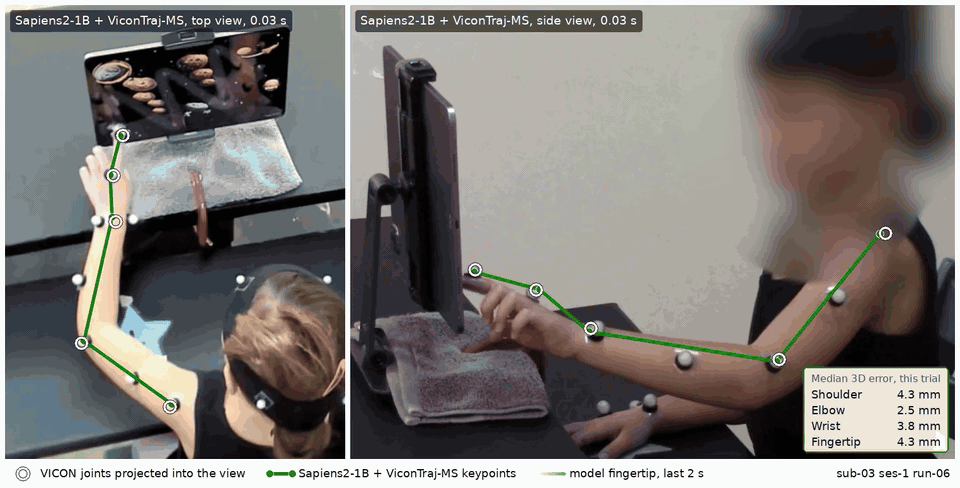

# ViKi-Traj: A Multi-modal Dataset and Benchmark for Markerless Video to Upper-Limb Kinematics


Code of the ViKi-Traj paper (anonymous submission). It aligns the three data streams of each trial (VICON markers, the
end-effector trajectory logged by the reaching game, and the top and side videos), projects the VICON markers into the
calibrated cameras as 2D labels, benchmarks eight pose models zero-shot and with ViconTraj-MS, makes the tables and
figures of the paper, and builds and validates the BIDS release of the dataset.


## Demo

One whole trial of a test participant: sub-03, visit 1, trial 6 (typically developing, left arm, 21.7 s). It is the
test trial with the lowest 3D error of Sapiens2-1B + ViconTraj-MS among the trials valid in VICON and in both views.



Sapiens2-1B + ViconTraj-MS in the top and side views ([full video](docs/media/demo_best_model.mp4)). Rings: VICON
joints of the active arm projected into the view; green: model keypoints, with a light trail for the model fingertip
over the last 2 s. The box gives the median two-view 3D error of the trial: shoulder 4.3, elbow 2.5, wrist 3.8 and
fingertip 4.3 mm.


The eight models in the top view, which films the participant from behind
([full video](docs/media/demo_all_models.mp4)). Each model is drawn zero-shot (dashed, lighter) and with ViconTraj-MS
(solid) in its color of the results figure below. ViconTraj-MS is fine-tuning for ViTPose+-B, pose-head training for
the two Sapiens2 models and a temporal head for the other five. The GIFs run at 10 fps; the MP4s have all 652 frames
at 30 fps. Both videos are drawn from the released files by `scripts/render_demo.py`.


## Dataset


Top: a participant plays the reaching game on an iPad while a 24-marker VICON system (100 Hz), an overhead (top) and a
side camera (30 Hz), and the game itself (end-effector trajectory, 120 Hz) record each trial without hardware
synchronization. Bottom: a trial of a TD participant at t = 8.2 s after alignment, with the VICON joints in 3D and
projected into both views, against the keypoints and errors of zero-shot Sapiens2-1B.

Children aged 5-12 years, typically developing (TD) or with unilateral cerebral palsy (UCP), drag a game object with
one finger along a curved path on an upright iPad. The VICON recordings and the videos are placed on the clock of the
game, and every trial has a row in the manifest with a validity flag per stream and the reason for each rejection.

| | Release v1.0 |
|---|---|
| Participants | 29 (18 TD, 11 UCP), two visits each |
| Trials | 696 (24 per participant), median 9.6 s, 128 min of movement |
| VICON | 24 markers (modified Plug-in Gait upper body), 100 Hz, 759,984 samples; 173 full recordings (C3D, 189 min) |
| End-effector trajectory | finger position on the screen, about 120 Hz, 804,462 samples; 7,315 trial and touch events |
| Video clips | 617 top, 650 side (419,367 frames, 233 min), 30 Hz, 1920x1080 (3 of the 116 source videos 1280x720) |
| Labels | 10 joints and 24 markers projected into each frame of 539 top and 535 side clips (357,068 frames) |
| Model outputs | 2D keypoints of 8 zero-shot and 8 ViconTraj-MS models (12,261 files), boxes, 3D tracks of 410 trials |
| Valid trials | VICON 556, top 522, side 488, all three streams 416 (72 min) |
| Size | 21,320 files, 12.6 GB |

The counts of samples, clips, frames, labels and files are those of Table 2 of the paper. The minutes, the events, the
source videos and the valid trials are from the datasheet in the supplementary material (the valid trials also from
its validity table) and from the dataset card. The heads of all persons are blurred in the side clips.

The layout is BIDS with the Motion-BIDS extension: one trial is one run, `ses-1` and `ses-2` are the two visits, and
`derivatives/vikitraj/` holds the manifest, splits, cameras, labels, model outputs, result tables and ViconTraj-MS
checkpoints. The dataset card, [dataset/README_card.md](dataset/README_card.md), describes the files and conventions.
The dataset will be released for research through a gated Hugging Face repository with a DOI at publication;
reviewers receive an anonymous copy (v1.0). One trial is in [sample_data/](sample_data/README.md).


## Benchmark


Eight baseline models zero-shot (solid) and with ViconTraj-MS (hatched, with the relative change); test split, active
arm, whiskers: 95% confidence interval. Columns: two-view 3D error of the fingertip (end-effector) and the wrist, RMSE
of the elbow flexion and shoulder elevation angles, and RMSE of the end-effector trajectory in game space, where the
dashed line is the VICON fingertip. The double dagger marks ViTPose+-B zero-shot, which has no fingertip keypoint: its
wrist is scored.

Three tasks, scored on 8 held-out test participants (5 TD, 3 UCP):

1. 2D and 3D upper-limb pose: error of the shoulder, elbow, wrist, hand and fingertip in each view and after two-view
   triangulation, against the VICON joints (E1, E2 in the code).
2. Kinematic features: elbow flexion and shoulder elevation angles (RMSE, range of motion), and the peak speed, time
   to peak speed, straightness, number of speed peaks, spectral arc length and log dimensionless jerk of the wrist and
   the end-effector (ICC(2,1) against VICON; E4).
3. End-effector trajectory: the fingertip estimate mapped to the screen and compared with the game trajectory (RMSE,
   length ratio, speed correlation; E3).

ViconTraj-MS (VICON and trajectory multi-modal supervision, E5) trains pose models on two references: the VICON joints
projected into each view, and the game trajectory projected through a screen plane fitted per VICON recording, which
labels the fingertip in every frame, also where its marker is hidden. ViTPose+-B is fine-tuned end to end, the pose
heads of Sapiens2-0.4B and Sapiens2-1B are trained on the frozen backbone, and the other five models, released as
inference graphs that cannot be trained, get a temporal head that corrects their keypoints. With ViconTraj-MS, the 3D
fingertip error of Sapiens2-1B falls from 22.5 to 9.6 mm, and fine-tuned ViTPose+-B has the lowest 3D wrist error,
7.1 mm against 14.1 mm for the best zero-shot model. ViTPose+-B reaches an RMSE of 4.8 deg for elbow flexion and
5.2 deg for shoulder elevation (12.6 and 7.5 deg for the best zero-shot models), and the ICC of the end-effector peak
speed and straightness against VICON rises from at most 0.31 to 0.82-0.88. The end-effector trajectory RMSE of
Sapiens2-1B falls from 5.8 to 4.1 mm, against 2.8 mm for the VICON fingertip. E6 holds the analyses (group and arm,
training size, alignment shift, views, filtering, selection) and E7 the qualitative figures.


## Repository layout

```
alignment/vicon/   MATLAB: VICON recordings placed on the game clock, trial crops, marker export
alignment/video/   top and side videos placed on the game clock, one clip per trial and view
alignment/         trajectory test of the VICON alignment, benchmark manifest (validity of each stream)
preprocessing/     raw game exports -> one MATLAB table per participant
src/               shared modules: camera model, filters, marker blobs, smoothness measures, model wrappers, face blur
benchmark/         splits, labels, cameras, zero-shot inference, ViconTraj-MS training, evaluation E1-E7
dataset/           builders and validator of the BIDS release, dataset card
paper/             tables and figures of the paper
pilot/             pilot participant of the supplement: VICON offset estimated from the game and from the video
scripts/           demo videos and sample data, made from the released dataset
sample_data/       one trial of the release
docs/media/        figures and videos of this page
slurm/             batch wrappers
```


## Pipeline

These steps produced the release and the results of the paper. Except `paper/dataset_stats.py`, which reads only the
release, they need the raw recordings (game exports, VICON files, visit videos), which are not public, and run on the
internal layout: raw data in `data/`, intermediate outputs in `outputs/`, the release in `release/ViKi-Traj/` and the
study-ID map in `release/private/`. A trial is called a path in the code (`aligned_paths.csv`,
`<pid>_reaching_paths_plain.mat`, `n_paths`). The steps run in the order of the table, from the repository root;
`ALIGNED` is `outputs/game_vicon_aligned/reaching/` and `BENCH` is `outputs/benchmark/`, as in `benchmark/benchlib.py`.

| Step | Scripts | Output |
|---|---|---|
| Game exports to MATLAB tables | `preprocessing/export_game_data.py` | `data/game_data/<pid>.mat` |
| VICON alignment (MATLAB) | `alignment/vicon/run_alignment.m`, then the exports | `ALIGNED/`, `BENCH/markers/` |
| Trajectory test | `alignment/trajectory_check.py` | `ALIGNED/trajectory_check.csv` |
| Video alignment and clips | `alignment/video/collect_outputs.py participants`, `align_videos.py` | `ALIGNED/video/` |
| Tables of all participants | `alignment/video/collect_outputs.py tables`, `clip_durations.py` | `ALIGNED/video/` |
| Manifest | `alignment/build_benchmark_manifest.py` | `ALIGNED/benchmark_manifest.csv` |
| Participant splits | `benchmark/import_splits.py --release <root> --id-map <id_map.tsv>` | `BENCH/splits.json` |
| Zero-shot pose, person boxes, marker blobs | `benchmark/zero_shot.py` | `BENCH/models/`, `boxes/`, `blobs/` |
| Cameras from the VICON markers | `benchmark/calibrate.py` | `BENCH/cameras/` |
| Marker and trajectory labels | `benchmark/labels.py`, `labels_traj.py`, `labels_shift.py` | `BENCH/labels*/` |
| ViconTraj-MS fine-tuning | `benchmark/finetune.py`, `finetune_sapiens.py` | `BENCH/finetune/` |
| ViconTraj-MS temporal heads | `benchmark/e5_seq.py --part seq2d` | `BENCH/finetune/`, `BENCH/models/seq_*/` |
| Fine-tuned model inference | `benchmark/zero_shot.py --participant <pid> --models <run>` | `BENCH/models/ft_*/` |
| E3 and the trajectory QA (before E1-E2) | `benchmark/e3_screen.py` | `BENCH/results/`, `qa_vicon_trajectory.csv` |
| E1-E2, E4, E6 | `benchmark/evaluate.py`, `e4_kinematics.py`, `e6_analyses.py` | `BENCH/results/`, `BENCH/tracks3d/` |
| Two-view lifting (after E4) | `benchmark/e5_seq.py --part lift3d` | `BENCH/results/E5_lift3d_*.csv` |
| E7 qualitative figures | `benchmark/e7_qualitative.py`, `e7_path_frames.py` | `BENCH/reports/E7/` |
| Release build and validation | `dataset/build_*.py`, `blur_clips.py`, `validate_release.py` | `release/ViKi-Traj/` |
| Paper tables and figures | `paper/make_*.py`, `dataset_stats.py` | `outputs/paper/` |

`collect_outputs.py participants` writes the participant list that the array jobs read. The participant split of the
paper was drawn once and ships with the release as `derivatives/vikitraj/splits.json` (sub-NN IDs);
`import_splits.py` maps it back to study IDs with the private ID map. E3 runs before E1-E2 because it writes the
trajectory QA that the later steps apply (`slurm/bench_final.sbatch`). The commands, inputs and outputs of each step are
in the folder READMEs: [alignment/vicon](alignment/vicon/README.md), [alignment/video](alignment/video/README.md),
[benchmark](benchmark/README.md), [dataset](dataset/README.md) and [paper](paper/README.md). The batch wrappers in
`slurm/` run the long steps on a Slurm cluster: submit them from the repository root, where they activate `.venv`;
array jobs take one participant per task (`--array=1-29`) and logs go to `slurm/logs/`. [pilot/](pilot/README.md)
reproduces the analysis of the pilot participant in the supplement. Its input is an earlier aligned trial table that
came with the data, not the output of `alignment/vicon/`; in that table the VICON data of the second visit were
0.8-1.3 s out of step with the game trajectory.


## Installation

Python 3.10 on Linux. The GPU steps ran on one NVIDIA V100 with PyTorch 2.7.1 and CUDA 11.8.

```bash
python -m venv .venv                  # Python 3.10
source .venv/bin/activate
pip install -r requirements.txt       # PyTorch from the CUDA 11.8 index
pip install --no-deps c3d==0.5.2      # C3D writer of dataset/: its metadata asks for numpy<2, the code runs on numpy 2
git clone https://github.com/facebookresearch/sapiens2.git third_party/sapiens2
```

The Sapiens2 code (package version 2.0.0) is imported from `third_party/sapiens2`, not installed; it runs under Python
3.10 although its `pyproject.toml` asks for 3.12. The frame reader of c3d 0.5.2 fails under numpy 2; read the released
C3D files with ezc3d or py-c3d 0.6 or later. MATLAB R2023a, without toolboxes, runs `alignment/vicon/` and
`pilot/export_trials.m`. Pretrained weights are not redistributed; the code reads them from `models/`:

| Model | Source | Under `models/` |
|---|---|---|
| RT-DETR (person boxes) | Hugging Face `PekingU/rtdetr_r50vd_coco_o365` | `hf_cache/` |
| ViTPose+-B | Hugging Face `usyd-community/vitpose-plus-base` | `hf_cache/` |
| RTMPose-WB | RTMPose-Body2d, ONNX float export of Qualcomm AI Hub | `rtmpose_body2d/rtmpose_body2d-onnx-float/` |
| DWPose-L | `dw-ll_ucoco_384.onnx` from Hugging Face `yzd-v/DWPose` | `onnx/` |
| RTMW-X, RTMPose-m hand | ONNX archives of the RTMPose project of MMPose (below) | `onnx/<archive name>/` |
| Sapiens2-0.4B, -1B | Hugging Face `facebook/sapiens2-pose-0.4b`, `facebook/sapiens2-pose-1b` | `sapiens2/pose/` |
| BlazePose + Hands | MediaPipe Tasks `pose_landmarker_heavy.task`, `hand_landmarker.task` | `mediapipe/` |
| YuNet (face blur) | OpenCV Zoo `face_detection_yunet_2023mar.onnx` | `face/` |

The Hugging Face models are cached in `models/hf_cache` (`HF_HOME`, set by `src/common.py` and
`benchmark/benchlib.py`); fill the cache once online, then set `HF_HUB_OFFLINE=1` on nodes without internet. The
two MMPose archives, `rtmw-dw-x-l_simcc-cocktail14_270e-384x288_20231122.zip` and
`rtmpose-m_simcc-hand5_pt-aic-coco_210e-256x256-74fb594_20230320.zip`, are unzipped into folders of the same name. The
Sapiens2 checkpoints keep their file names, `sapiens2_0.4b_pose.safetensors` and `sapiens2_1b_pose.safetensors`.
The ONNX models run on the CPU, except in `slurm/bench_onnx_gpu.sbatch`, which runs DWPose-L, RTMW-X and RTMPose-m
hand on the GPU with onnxruntime-gpu and its CUDA 12 / cuDNN 9 libraries, installed apart from the main environment:

```bash
pip install --no-deps --target models/pylib_ort_gpu onnxruntime-gpu==1.23.2 nvidia-cublas-cu12==12.9.3.13 \
    nvidia-cudnn-cu12==9.27.0.42 nvidia-cuda-runtime-cu12==12.9.79 nvidia-cuda-nvrtc-cu12==12.9.86 \
    nvidia-cufft-cu12==11.4.1.4 nvidia-curand-cu12==10.3.10.19 nvidia-nvjitlink-cu12==12.9.86
```


## Using the released data

The snippet, the demo, the sample and `paper/dataset_stats.py` read only the released dataset; they need neither the
raw data nor a GPU.

```python
import pandas as pd

root = "sample_data/ViKi-Traj"  # or the full release
trials = pd.read_csv(f"{root}/derivatives/vikitraj/manifest.tsv", sep="\t", na_values="n/a")
t = trials[(trials.vicon_valid == True) & (trials.top_valid == True)].iloc[0]

def motion(path):  # motion.tsv has no header; the column names are in its channels.tsv
    names = pd.read_csv(f"{root}/{path.replace('_motion.tsv', '_channels.tsv')}", sep="\t").name
    return pd.read_csv(f"{root}/{path}", sep="\t", header=None, names=names, na_values="n/a")

vicon = motion(t.vicon_motion)  # 24 markers (x, y, z in mm, lab frame) at 100 Hz from the movement start
ipad = motion(t.ipad_motion)    # end-effector trajectory: latency (s), finger position on the screen (mm)
labels = pd.read_csv(f"{root}/{t.top_labels}", sep="\t", na_values="n/a")  # VICON joints projected, px per frame
kp_file = t.top_labels.replace("labels2d/", "keypoints2d/ft_sapiens2_1b_head/").replace("_labels", "_keypoints")
keypoints = pd.read_csv(f"{root}/{kp_file}", sep="\t", na_values="n/a")  # Sapiens2-1B + ViconTraj-MS
video = f"{root}/{t.top_video}"  # top clip of the trial
```

```bash
python scripts/render_demo.py --root path/to/ViKi-Traj [--trial sub-03 ses-1 run-06] [--view top]
python scripts/make_sample.py --root path/to/ViKi-Traj [--trial sub-03 ses-1 run-06] [--out sample_data/ViKi-Traj]
python dataset/validate_release.py --root path/to/ViKi-Traj --scrub-terms /dev/null --jobs 8
python paper/dataset_stats.py --release path/to/ViKi-Traj   # Table 2 -> outputs/paper/tables/dataset_stats.tex
```

`render_demo.py` draws the two demo videos of this page, MP4 and GIF, for any trial with 3D tracks
(`derivatives/vikitraj/tracks3d/`, 410 trials) in about 1.5 min on a CPU, writes them to `docs/media/`, and prints the
median 3D error per joint; the temporal-head outputs, and with them the ViconTraj-MS keypoints of five models in the
grid, exist only for the test participants. `make_sample.py` copies one trial into the release layout, as in
[sample_data/](sample_data/README.md), which holds the trial's two clips but no checkpoints or result tables.
`validate_release.py` checks a copy of the release for identifiers, dates and clock times, completeness, file formats
and the counts of the paper, and prints one line per problem; `/dev/null` as term list skips only the search for private
terms. On release v1.0 it reports 0 problems in 21,320 files.

`dataset_stats.py` reproduces Table 2 of the paper from the release alone (about 1 min). The other tables and figures
are written from the internal outputs (`paper/make_results.py`, `make_tables.py`), but the numbers behind the
results figure, the result tables and the supplementary results are released in `derivatives/vikitraj/results/`, one
TSV per experiment output, with their columns in its README.


## Acknowledgements

Pretrained models: ViTPose+ (Apache-2.0), RT-DETR (Apache-2.0), RTMPose, RTMW and RTMPose-m hand of OpenMMLab MMPose
(Apache-2.0; RTMPose-WB as exported by Qualcomm AI Hub), DWPose (Apache-2.0), Meta Sapiens2 (Sapiens2 License), Google
MediaPipe BlazePose and Hands (Apache-2.0), and the YuNet face detector of the OpenCV Zoo (MIT). The release follows
BIDS and its Motion-BIDS extension.


## Citation

Withheld for double-blind review.


## License

To be added at publication; the pretrained weights keep their own licenses.
